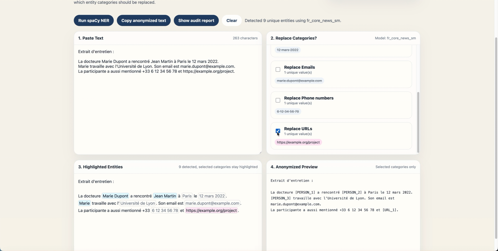

# ✨ Incognito

**Anonymisez vos corpus qualitatifs dans le navigateur — sans envoyer vos données dans le cloud.**

Outil pour les sciences humaines et sociales — entretiens, notes de terrain, réponses ouvertes. **Interface web** uniquement : détectez les entités sensibles, contrôlez ce qui est remplacé, exportez un texte anonymisé et une trace de vos décisions.

Développé par [Xiaoou Wang](https://xiaoouwang.github.io/) · Ingénieur en Humanités Numériques · [MSHS Sud-Est](https://mshs.univ-cotedazur.fr/) · [Université Côte d'Azur](https://univ-cotedazur.fr/)

**Version actuelle : 1.0.4** (web)

**Dépôt canonique** — [GitLab Huma-Num](https://gitlab.huma-num.fr/mshs-sud-est/incognito) · miroir public : [GitHub](https://github.com/xiaoouwang/Incognito)

**🌐 [Incognito Web](https://mshs-sud-est.gitpages.huma-num.fr/incognito/)** — **quatre parcours** : anonymisation **de base** (GLiNER2 NER seul), **avancée** (GLiNER2 + ReLex / graphe), **générative locale** et **générative API** (Albert) ; **graphe de personnes** ; détection locale, relecture interactive ; **Export everything**. *Tout s'exécute localement — vos données ne quittent pas votre ordinateur* (sauf appel Albert en mode API, avec votre clé). Miroir : [GitHub Pages](https://xiaoouwang.github.io/Incognito/).

> **Choix de maintenance (2026-11)** — Les applications de bureau (Electron + spaCy / CamemBERT) sont moins soutenables à long terme (chaînes de build multi-OS, emballage PyInstaller, releases binaires). Le projet se concentre désormais **uniquement sur l'interface web** dans le navigateur : un seul déploiement, mise à jour continue, et le même niveau de confidentialité locale pour les parcours NER.



---

## 🔒 Pourquoi cet outil ?

|                              |                                                                        |
| ---------------------------- | ---------------------------------------------------------------------- |
| 🏠 **100 % local (navigateur)** | Analyse dans le navigateur — seuls les poids du modèle sont téléchargés, jamais vos textes (sauf Albert en mode API). |
| 🌍 **Sans installateur**      | Ouvrez **[Incognito Web](https://mshs-sud-est.gitpages.huma-num.fr/incognito/)** — aucun `.dmg` / `.exe` / `.AppImage`. |
| 🇫🇷 **Pensé pour le français** | GLiNER2, ReLex et parcours qualitatifs adaptés aux entretiens et notes de terrain. |
| 👁️ **Contrôle humain**        | Vous validez, corrigez et désactivez entité par entité avant l'export. |
| 📋 **Traçabilité**            | Rapport d'audit, correspondance original ↔ remplacé, Label Studio, ZIP lot. |

> ⚠️ Assistant d'anonymisation, pas une garantie d'anonymat total. Relisez toujours le résultat avant diffusion.

---

## 🚀 En bref

1. **Importez** un texte, un dossier, ou des fichiers (`.txt`, `.docx`)
2. **Lancez l'anonymisation** — *Run Anonymization*
3. **Affinez** catégories et occurrences (personnes, lieux, organisations, dates, e-mails…)
4. **Exportez** texte anonymisé, rapport, Label Studio, ou **Export everything** (ZIP)

Placeholders stables du type `[PER_1]`, `[LOC_1]`, `[ORG_1]`, `[EMA_1]` — trois lettres de catégorie + numéro.

Disponibles dans l'interface web :

- 🔍 **NER configurable** — **de base** (GLiNER2-multi ou GLiNER2-PII ONNX), **avancée** (GLiNER2 + ReLex), **générative locale** et **générative API** (Albert)
- 🕸️ **Graphe de personnes** — aliases / attributs / relations ; vue **react-force-graph** ; soft-exclude ; export CSV
- 📧 **Règles regex** — e-mails, URL, téléphones (prioritaires en mode avancé)
- 🖍️ **Revue interactive** — surlignage, œil (anonymiser / garder), × / ↩ (retirer / rétablir une valeur), suppression / changement de catégorie (une occurrence ou toutes), codes liés / occurrences distinctes, pagination des longs textes
- 📁 **Mode lot** — dossier ou fichiers choisis, vagues de traitement, ZIP ; fins de ligne CR/CRLF normalisées à l'import
- 🏷️ **Label Studio** — pré-annotations + configuration XML
- 📊 **Rapport d'audit** — provenance, positions de caractères (start/end) ; fenêtre de lecture pleine hauteur

---

## ⚙️ Stack

| Couche   | Outils |
| -------- | ------ |
| 🌐 App   | React, Vite (`web_interface/`) |
| 🧠 NER   | GLiNER2 ONNX (multi / PII), ReLex (avancé), ONNX Runtime WASM |
| 🔗 API   | Albert (mode génératif) + Worker Cloudflare CORS (`albert-proxy/`) |
| 📦 Deploy | **GitLab CI Pages** (Huma-Num) · miroir GitHub Actions Pages |

---

## 🌐 Utilisation

**[Essayer en ligne (Huma-Num)](https://mshs-sud-est.gitpages.huma-num.fr/incognito/)** · miroir [GitHub Pages](https://xiaoouwang.github.io/Incognito/) · détails : [`web_interface/README.md`](web_interface/README.md)

| Mode | Moteur | Usage typique |
| ---- | ------ | ------------- |
| **De base** | GLiNER2-multi ou GLiNER2-PII ONNX | NER multi-étiquettes local, sans graphe |
| **Avancé** | GLiNER2 + ReLex + regex | NER + **graphe de personnes** |
| **Génératif local** | Pipeline local / Albert local | Revue générative sans cloud (selon config) |
| **Génératif API** | Albert (API) | Graphe / relations via LLM + revue |

---

## 🛠️ Développeurs

**Prérequis** — Node.js 20+

```bash
# Dépôt canonique (Huma-Num)
git clone https://gitlab.huma-num.fr/mshs-sud-est/incognito.git
cd Incognito

# Depuis la racine (délègue à web_interface/)
npm run dev

# Ou directement :
cd web_interface
npm install
npm run dev
```

Build statique :

```bash
npm run build          # → web_interface/dist/
npm run preview
```

Scripts utiles : `scripts/benchmark_albert.py` (latence Albert) · sidecar optionnel `web_interface/gliner2_pii_server/`.

### Déploiement

- **Canonique** — push `main` sur GitLab → [`.gitlab-ci.yml`](.gitlab-ci.yml) → [mshs-sud-est.gitpages.huma-num.fr/incognito/](https://mshs-sud-est.gitpages.huma-num.fr/incognito/)
- **Miroir** — même `main` sur GitHub → [`.github/workflows/deploy-web.yml`](.github/workflows/deploy-web.yml) → [xiaoouwang.github.io/Incognito/](https://xiaoouwang.github.io/Incognito/)

Les changements hors `web_interface/` (et hors les fichiers CI) ne redéploient pas le site.

---

## 📚 Citer cet outil

> Wang, X. (2026). *Incognito: A privacy-first tool for reviewing and anonymizing qualitative texts in the social sciences* (Version 1.0.4) [Logiciel]. Maison des Sciences de l'Homme Sud-Est / Université Côte d'Azur. [https://gitlab.huma-num.fr/mshs-sud-est/incognito](https://gitlab.huma-num.fr/mshs-sud-est/incognito)

**BibTeX**

```bibtex
@software{wang2026incognito,
  author  = {Wang, Xiaoou},
  title   = {{Incognito}: A privacy-first tool for reviewing and anonymizing qualitative texts in the social sciences},
  year    = {2026},
  version = {1.0.4},
  url     = {https://gitlab.huma-num.fr/mshs-sud-est/incognito},
  note    = {Browser interface (React + GLiNER2 / Transformers.js).
             Maison des Sciences de l'Homme Sud-Est, Universit{\'e} C{\^o}te d'Azur.
             Mirror: https://github.com/xiaoouwang/Incognito}
}
```

Fichier [`CITATION.cff`](CITATION.cff) également disponible.

---

## 📜 Note

Les rapports d'audit peuvent contenir des valeurs sensibles : manipulez-les comme vos données sources.

**Contact** — [xiaoou.wang@univ-cotedazur.fr](mailto:xiaoou.wang@univ-cotedazur.fr)

---

## 📄 License

Copyright (c) 2026 Xiaoou Wang

**Incognito** is free and open-source software released under the [GNU Affero General Public License v3.0 (AGPLv3)](LICENSE).

---

## 📝 Mises à jour

### 2026-11-26 — v1.0.4 — suppression par lot & comptage des correspondances

Fixes [#7](https://github.com/xiaoouwang/Incognito/issues/7) (batch deletion ignored the “All matching detections” scope).

- **Suppression groupée** — le sélecteur de portée du menu d’entité s’applique aussi à **Remove** (une occurrence ou toutes les valeurs identiques), comme pour le changement de catégorie ; libellé du bouton adapté (`Remove all matching (N)`).
- **Ajout / recomptage** — « All word matches » ne compte plus les faux positifs dans les e-mails (`marie.dupont@…`) ni les spans déjà couverts par une détection plus longue (ex. `Marie` dans `Marie Dupont`) ; l’ajout respecte la même liste.

### 2026-11-25 — v1.0.3 — catégories, codes d’entité, menu de revue

Fixes [#3](https://github.com/xiaoouwang/Incognito/issues/3), [#4](https://github.com/xiaoouwang/Incognito/issues/4), [#5](https://github.com/xiaoouwang/Incognito/issues/5).

- **Décision — suivre les surfaces NER, puis laisser l’humain unifier ou séparer** — `Marie Dupont` et `Marie` ont des codes distincts par défaut (ordre = première apparition dans le texte). **Same code as** lie deux orthographes ; **Treat as distinct** isole une occurrence ; la régénération du graphe de personnes respecte ces choix.
- **Changer de catégorie** — menu d’entité : déplacer une occurrence ou toutes les valeurs identiques (y compris vers une catégorie personnalisée, ex. *Industry sector*).
- **Menu d’édition** — plus compact ; **New category** sous les puces ; positionnement qui reste dans le viewport (plus de fenêtre coupée au bord droit).
- **Doublons de catégories** — alias (`person name` / `phone number`) masqués dans Ajouter / Changer ; les labels canoniques restent une seule fois.
- **Démo toy** — même résolution des chevauchements qu’un run live (`mergeEntities`), pour des codes / surlignages cohérents dès l’ouverture.

### 2026-11-24 — v1.0.2 — longs textes, workers, puces ×/↩, lot & audit

Fixes [#2](https://github.com/xiaoouwang/Incognito/issues/2) (long interviews freezing the web UI).

- **Décision — rester fluide sur de longs entretiens** — la détection NER / ReLex ne doit plus bloquer l'UI Chrome sur des textes type entretien (ex. `web_interface/edge_cases/`). Travail déplacé vers des **Web Workers** (`gliner2DetectWorker`, `glinerRelexWorker`), avec progression, `yieldToMain` et peints incrémentaux des surlignages.
- **Décision — paginer plutôt qu'afficher tout d'un coup** — au-delà d'un seuil, Original / Anonymized se découpent en pages (~4500 caractères) avec navigation fléchée (`TextPageNav`, `textPages.js`), pour éviter le gel des puces et du DOM.
- **Décision — retirer ≠ masquer** — l'œil continue d'inclure / exclure une valeur de l'anonymisation ; **×** retire la détection (tous les spans de cette valeur). Les valeurs retirées passent **sous une ligne** dans la catégorie ; **↩** les rétablit. Ainsi on peut revenir sur une décision sans relancer le modèle.
- **Person names** — catégorie « person name » normalisée / priorisée en tête de revue ; filtre des pronoms issus de mentions personne.
- **Mode lot** — normalisation des fins de ligne (`\r` / `\r\n` → `\n`) et BOM à l'import, pour que les `.txt` « Mac classique » gardent leurs paragraphes.
- **Audit** — hauteur de fenêtre corrigée (lecture pleine hauteur) ; construction du rapport allégée côté UI.
- Pas de dialogue de « permission » pour les longs textes : le parcours reste direct (workers + pagination).

### 2026-11-23 — Web only : retrait de l'application de bureau

- **Décision** — arrêter la maintenance Electron / spaCy / CamemBERT bureau (builds multi-OS peu soutenables) et **focaliser le dépôt sur l'app web**.
- Suppression du code bureau (`electron/`, `src/` Electron, PyInstaller, `release.yml`, textes NER de test bureau, etc.).
- Racine réduite à un `package.json` mince qui délègue à `web_interface/`.
- Documentation et citations recentrées sur GitLab Huma-Num + Pages web.

### 2026-11-23 — UX revue, exports enrichis et déploiement Huma-Num

- **Paste your own text** — surface de collage ; layout textarea (grille CSS) multi-navigateurs.
- **Défilement** — panneaux Original / Anonymized et wrappers d'erreur dans la chaîne flex.
- **Exports** — *Export everything* ; positions start/end ; exports graphe enrichis.
- **Avancé** — régénération ReLex live ; polarité des puces œil.
- **CI** — Pages Huma-Num + miroir GitHub ; `.npmrc` saute CUDA `onnxruntime-node`.

### 2026-10-23 — v1.0.1 — GLiNER2, ReLex, force-graph et modes génératifs

- Parcours Basic / Advanced / Local generative / API-based.
- Vue graphe **react-force-graph-2d** ; placeholders / pseudonymes / généralisation.
- Lot par vagues ; échantillons multilingues sous `web_interface/samples/`.

### Historique antérieur

Le détail des versions 0.x / 1.0.0 (dont l'ancienne app de bureau) reste dans l'historique Git et dans [`docs/WEB_INTERFACE_EVOLUTION.md`](docs/WEB_INTERFACE_EVOLUTION.md).
